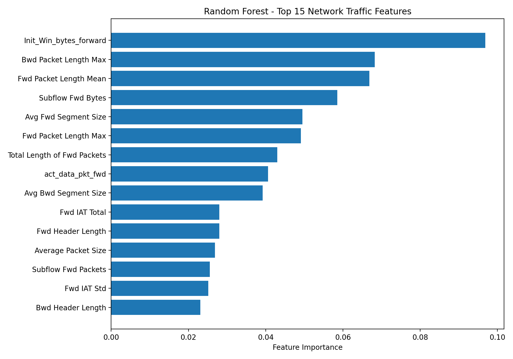

# Network Anomaly Detection

Exploring machine learning for network traffic analysis, DDoS detection, and eventually telecom fault diagnosis.

I started this project to investigate how well conventional ML models identify abnormal network traffic, and more importantly, whether their performance holds up when the evaluation conditions change.

My background is in telecom network operations, where I've worked with network monitoring, traffic anomalies, outages, and incident investigation. I'm interested in connecting that operational experience with machine learning.

## What I've done so far

The initial experiments use the Friday DDoS traffic from [CIC-IDS2017](https://www.unb.ca/cic/datasets/ids-2017.html).

The dataset contains 225,745 flows, including 128,027 labeled as DDoS.

I trained a Random Forest classifier using flow-level statistics such as packet lengths, inter-arrival times, TCP window sizes, and forward/backward traffic characteristics.

So far, I've tested:

- A basic Random Forest classifier.
- Feature importance to identify which traffic characteristics the model relies on.
- Feature ablation, removing the most important features and retraining.
- A block-holdout evaluation instead of relying only on a random train/test split.

## Results

| Experiment | Accuracy |
|---|---:|
| Random train/test split | 99.985% |
| Remove top 5 features | 99.985% |
| Remove top 15 features | 99.985% |
| Block holdout | 99.740% |

The initial accuracy was surprisingly high.

Even after removing the 15 highest-ranked features, performance barely changed. That could indicate considerable redundancy among the flow features, or simply that this particular dataset is relatively easy for the model to separate.

I then tried a different evaluation: training on the first 175,000 rows and testing on the remaining 50,745.

The model made 132 incorrect predictions:

- 88 benign flows classified as DDoS.
- 44 DDoS flows classified as benign.

The block-holdout result is still strong, but it raises questions about how much the evaluation setup influences performance. The experiments also use different training-set sizes, so the results aren't directly controlled comparisons.

**These numbers don't establish that the model would perform equally well on another network.** All completed experiments use the same CSV, and the file doesn't include timestamps that would let me verify chronological order.

## Feature importance

Some of the highest-ranked features were:

- `Init_Win_bytes_forward`
- `Bwd Packet Length Max`
- `Fwd Packet Length Mean`
- `Subflow Fwd Bytes`
- `Avg Fwd Segment Size`

The feature importance analysis uses Random Forest's built-in impurity-based importance, which can be affected by correlated variables.



## Running the experiments

Install the dependencies:

```bash
python3 -m venv .venv
source .venv/bin/activate
pip install -r requirements.txt
```

Download the Friday DDoS CSV from CIC-IDS2017 and save it as `data/raw/ddos.csv`.

Then run:

```bash
python src/train.py
python src/feature_importance.py
python src/ablation.py
python src/block_holdout.py
```

## What's next?

The main question I'm working on is whether these models learn useful network behavior or just patterns specific to the training capture.

My next steps are to test against independent DDoS traffic, compare results across different evaluation strategies, and investigate whether operational telemetry such as latency, packet loss, link utilization, and interface errors can help distinguish security incidents from ordinary network faults.

I'm also experimenting with a separate telecom fault-classification pipeline. Its initial data is synthetic and is only intended for software development, not real-world validation.

The longer-term goal is to investigate context-aware anomaly detection that combines network security indicators with operational network measurements.

## About

I'm a telecommunications engineer currently pursuing research in computer networks, with previous experience in NOC operations and network incident management.

I'm using this project to explore practical applications of machine learning in network security and fault investigation.